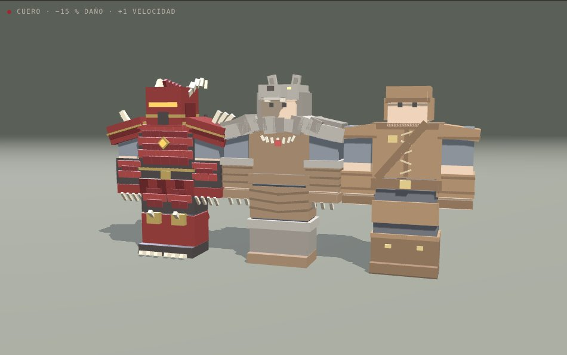

# Armaduras de bloques para Roblox: cuero, lobo y dragón

Tres armaduras al estilo Roblox, **hechas de Parts (bloques)** que se sueldan al cuerpo del jugador. Funcionan con R15 y con R6, y con cualquier tamaño de avatar. No hace falta importar ningún modelo: el instalador lo crea todo en Studio, incluidos tres maniquíes para probarlas.



## Las tres
| Armadura | Aspecto | Daño | Velocidad |
|---|---|---|---|
| **Cuero** | Capucha, jubón con cordones, correa cruzada con hebillas de latón, cinturón con bolsas, hombreras, brazales, guantes, musleras y botas | −15 % | +1 |
| **Lobo** | Yelmo de cabeza de lobo (hocico, orejas, colmillos, ojos que brillan), capa de piel, collar de dientes, hombreras de piel con garras, guanteletes con garras, cola y botas | −25 % | +2 |
| **Dragón** | Yelmo con visera que brilla, cresta y cuernos; peto de escamas con gema; púas en la espalda; alas plegadas; hombreras con púas; faldón de escamas; cola; grebas y botas con garras | −45 % | −1 (es pesada) |

Piezas: cuero 46, lobo 95, dragón 173.

## En el juego
- **Maniquíes**: el instalador pone tres maniquíes en `Workspace.ArmorStands` con la armadura puesta y un cartel. Acércate y mantén **E** para equiparla; si ya la llevas, te la quita.
- **Defensa**: de cada pérdida de vida se devuelve el porcentaje de la armadura. Sirve para cualquier daño: lobos, infectados, dragones, caídas o armas.
- **Velocidad**: se suma a tu `WalkSpeed` y se restaura al quitarla.
- **Al morir** la conservas: reapareces con ella puesta.
- **Desde otros scripts del servidor** (una tienda, un cofre, una recompensa):
  ```lua
  game.ReplicatedStorage.Armor.EquipArmor:Invoke(player, "Dragon")  -- "Leather", "Wolf", "Dragon"; nil para quitarla
  ```
- **Ajustes**: la reducción y la velocidad se cambian en `ReplicatedStorage.Armor.ArmorData` (`stats`). La posición de los maniquíes, en `STANDS_ORIGIN`, al principio del instalador.

## Cómo encaja en cualquier avatar (`roblox/ArmorBuilder.lua`)
- Cada pieza está colocada respecto al centro de una parte del cuerpo R15 del maniquí por defecto.
- Se **escala por eje** al tamaño real de esa parte, así que se adapta a avatares altos, bajos, anchos o delgados.
- **R6**: las piezas de brazo, antebrazo y mano se reparten a lo largo del brazo R6 (igual con piernas y torso).
- Todas las piezas son `Massless`, sin colisión y soldadas con `WeldConstraint`: no cambian cómo se mueve ni cómo salta el personaje.

## Instalación
1. Pega todo `roblox/InstallArmor.lua` en **View › Command Bar** y pulsa Enter.
   - Crea `ReplicatedStorage.Armor` (ArmorData, ArmorBuilder), `ServerScriptService.ArmorService` y los maniquíes.
2. **Play**, acércate a un maniquí y mantén **E**.

## Qué está verificado y qué no
- ✅ Los planos generan las tres armaduras en el visor de la ficha; las capturas salen de ahí.
- ✅ El Luau compila sin errores.
- ✅ `tools/test_armor.js` comprueba:
  - que el reparto R15 → R6 cubre la parte R6 de arriba abajo, sin huecos;
  - que la reducción de daño devuelve lo correcto, no cura sin daño y tiene un tope del 95 %;
  - que cada armadura cubre todas las partes del cuerpo y es simétrica.
- ⚠️ **No se ha ejecutado dentro de Roblox Studio.** Falta confirmar:
  - el instalador;
  - que las piezas encajan bien en avatares reales (sobre todo cabezas de malla y ropa en capas);
  - la reducción de daño contra armas que matan de un golpe (ponen la vida a 0 y la armadura no puede devolverla).

## Regenerar
```
node tools/build_roblox.js && node tools/test_armor.js /ruta/a/luau
```
