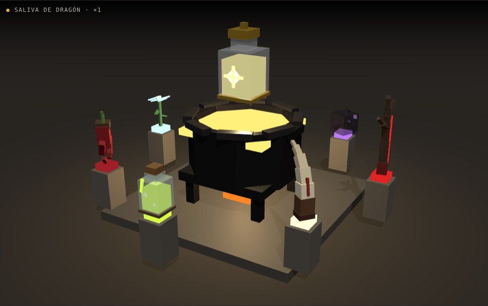
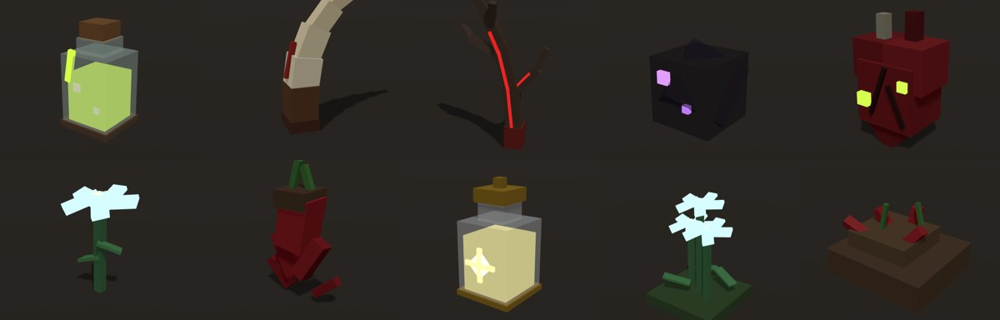

# La cura: el Remedio del Alba (objetivo del juego)

El objetivo del juego: no es una vacuna, es un **brebaje**. Hay que reunir siete ingredientes que se arrancan a las criaturas y al bosque, cocerlos en un caldero y usar el remedio. Al usarlo, los infectados se deshacen en luz, dejan de aparecer y amanece.



## La receta
| Ingrediente | Cantidad | Dónde se consigue |
|---|---|---|
| **Saliva de dragón** | 1 | Matando al **dragón de la guarida** (un jefe nuevo, ver abajo) |
| **Colmillo de alfa** | 1 | La suelta el **lobo alfa** al morir |
| **Asta maldita** | 1 | La deja caer un **ciervo maldito** al transformarse |
| **Perla negra** | 1 | La lleva dentro el **pez infectado gigante**; flota en el agua al morir |
| **Corazón del bruto** | 1 | Lo suelta el **infectado bruto** al morir |
| **Flor de luna** | 3 | Plantas que **solo se abren de noche**; de día se ven cerradas y no se pueden coger |
| **Raíz de sangre** | 2 | Montículos de tierra removida: mantén **E** para desenterrarla |

Lo que suelta una criatura aparece en el suelo, brilla, lleva su nombre encima y se coge al tocarlo, como cualquier herramienta de Roblox. Todos los jugadores ven un aviso.



## Cómo se prepara
1. **Echar ingredientes**: en el caldero (`Workspace.CureCauldron`), mantén **E**. Echa todo lo que lleves en la mochila que le falte a la receta.
   - Cada peana alrededor del caldero se enciende con el color de su ingrediente.
   - El progreso es de **todo el servidor**: cualquiera puede ayudar.
2. **Preparar**: con los siete, mantén **E** de nuevo. Tarda **90 s**, mientras el líquido pasa de verde a dorado y burbujea.
   - Es un buen momento para una horda: `ReplicatedStorage.Cure.CureBrewingStarted` avisa (BindableEvent).
3. **Coger el remedio** del caldero (E) y **usarlo** con clic.
   - Pantalla final («El Remedio del Alba») con música, para todos.
   - Se desactivan `InfectedSpawner` y `FishSpawner`, los infectados y los peces infectados se disuelven en luz y amanece.
   - `ReplicatedStorage.Cure.CureCompleted` avisa con el jugador que la usó.

**Recetario en el juego**: el botón «Cura 2/7» arriba a la derecha (o la tecla **R**). Muestra qué falta, cuánto y una pista de dónde buscarlo.

## El dragón de la guarida (jefe)
Los dragones que ya tienes eran modelos animados sin vida; el de las sombras es un acechador al que no se puede matar. Por eso la cura trae un **jefe**:
- Usa el **Dragón Depredador** instalado (o el **Aberrante**; se elige con `BOSS_DRAGON`).
- Vive en `Workspace.DragonLair`: un claro con rocas y huesos, en `LAIR_POS`.
- Tiene **Humanoid con 2500 de vida**, así que las armas de Roblox le hacen daño. Se ve su barra de vida.
- **Comportamiento**: ruge al verte, te persigue dentro de su guarida y muerde (35 de daño, con recarga). Si te alejas, vuelve a su sitio.
- **Al morir**: suelta la **saliva de dragón** y reaparece a los 10 minutos si la cura aún no se ha usado.
- Lo anima cada cliente con `DragonAnimator` y las animaciones de ese dragón (Idle, Walk, Roar, Attack, Death).

## Para tus propias criaturas
Cualquier modelo con Humanoid y el atributo `CureDrop = "<id>"` suelta ese ingrediente al morir. Los ids son `DragonSaliva`, `AlphaFang`, `CursedAntler`, `BlackPearl`, `BruteHeart`, `Moonflower` y `BloodRoot`. Las cantidades y las pistas se cambian en `ReplicatedStorage.Cure.Recipe`.

## Sonido (`sounds/`, generados con `tools/make_sounds.py`, sin muestras de terceros)
| Sonido | Cuándo suena |
|---|---|
| Pickup | Aparece un ingrediente |
| Harvest | Coger una flor o desenterrar una raíz |
| Add | Echar algo al caldero |
| Brew | Burbujeo mientras se prepara (en bucle) |
| Ready | El remedio está listo |
| Dawn | El final |

Hay que subirlos y pegar sus ids en `SOUND_IDS`.

## Instalación
1. Instala antes lo que quieras usar: el dragón Depredador o el Aberrante (para el jefe), los lobos, los ciervos, los infectados y los peces infectados.
2. Pega todo `roblox/InstallCure.lua` en **View › Command Bar** y pulsa Enter.
   - Pon el caldero en tu campamento con `CAULDRON_POS`.
   - La guarida va en `LAIR_POS`; si ya tienes una, `CREATE_LAIR = false` y una parte con la etiqueta `DragonLair`.
   - Las plantas crecen alrededor de `PLANT_CENTER`, o en partes con las etiquetas `MoonflowerSpot` y `BloodRootSpot`.
3. **Play**, y pulsa **R** para ver la receta.

## Qué está verificado y qué no
- ✅ Los modelos se ven bien en el visor de la ficha; las capturas salen de ahí.
- ✅ El Luau compila sin avisos de `luau-analyze`.
- ✅ `tools/test_logic.js` comprueba:
  - que no se puede echar de más y que la receta se completa con todo;
  - que cada criatura suelta lo suyo y solo eso, y que `CureDrop` manda;
  - que la noche se calcula bien;
  - que la preparación solo empieza con todo, tarda lo que tiene que tardar y el remedio se usa una vez;
  - que el jefe ruge, persigue, ataca con recarga, vuelve a su guarida y muere una sola vez;
  - que cada ingrediente tiene su modelo.
- ⚠️ **No se ha ejecutado dentro de Roblox Studio.** Falta confirmar:
  - el instalador y el caldero;
  - **el jefe con el modelo real del dragón**: cómo se ancla, hacia dónde mira y que lo animen los clientes;
  - que las armas le dan (depende de cómo detecte el arma al Humanoid);
  - que los botines aparecen al morir cada criatura (lobo alfa por su atributo Health; infectados y peces por su Humanoid; ciervo al transformarse).
- El progreso no se guarda entre servidores (empieza de cero en cada partida).

## Regenerar
```
python tools/make_sounds.py
node tools/build_roblox.js && node tools/test_logic.js /ruta/a/luau
```
