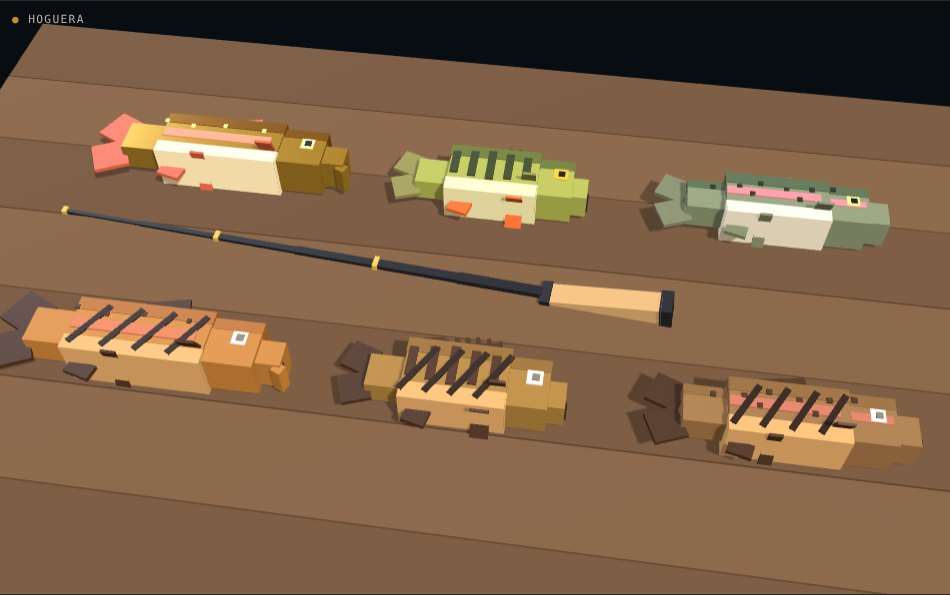

# Pesca: caña, peces comestibles y hoguera para Roblox

Un sistema de pesca de bloques: **lanzas la caña al agua, esperas a que pique, clavas el anzuelo y recoges**. Lo que sacas es un pez que **te puedes comer**, crudo o mejor **cocinado en una hoguera**. No hace falta importar ningún modelo: el instalador lo construye todo con Parts.



## Los peces
| Pez | Sale | Recoger | Crudo | Cocinado |
|---|---|---|---|---|
| **Trucha**: plateada y oliva, banda rosa y pintas | 60 % | fácil | +8 vida · +15 comida | +25 vida · +35 comida |
| **Perca**: verde amarillenta, barras oscuras, aletas naranjas | 30 % | media | +6 vida · +12 comida | +20 vida · +30 comida |
| **Salmón dorado** (raro): dorado brillante, aletas rojizas | 10 % | difícil | +15 vida · +25 comida | +50 vida · +60 comida |

Cocinado cambia de aspecto: piel tostada, vientre dorado, aletas chamuscadas, ojos blancos y marcas de parrilla.

## Cómo se pesca
1. **Lanza**: con la caña en la mano, clic en el agua, a menos de 45 studs. La boya vuela en arco y queda flotando, atada con el sedal (un `Beam`).
2. **Espera** entre 4 y 12 s. Si haces clic antes de que pique, espantas al pez.
3. **¡Pica!** La boya se hunde, salpica y suena. Tienes 1,3 s para hacer clic.
4. **Recoge**: aparece una barra. Cada clic la llena y el pez la vacía; el salmón dorado tira mucho más. Si se vacía, o si tardas más de 15 s, se escapa.
5. **Lo sacas**: va a tu mochila.

En móvil funciona igual con toques; si el toque no apunta al agua, se lanza al agua que haya delante del jugador.

## Comer y cocinar
- **Comer**: con el pez en la mano, clic. Cura y, si tu juego usa el atributo `Hunger` en el jugador (o en el personaje), lo sube; el máximo es 100.
- **Crudo**: hay un 25 % de que te siente mal y pierdas 10 de vida poco a poco.
- **Cocinar**: acércate a una hoguera con el pez crudo en la mano y mantén **E**. Te lo cambia por el cocinado.
- **Para tu juego**: `ReplicatedStorage.Fishing.FishEaten` (BindableEvent) avisa con `(player, especie, cocinado, vida, comida)`, por si quieres misiones, logros o tu propio sistema de hambre.
- **Hogueras**: cualquier parte o modelo con la etiqueta `Campfire`, o dentro de `Workspace.Campfires`.

## Dónde se pesca
En cualquier **agua de Terrain** y en las zonas **`FishZone`**. Las del pez infectado también cuentan: si pescas allí, cuidado, que los infectados saltan a la orilla.

## Sonido (`sounds/`, generados con `tools/make_sounds.py`, sin muestras de terceros)
| Sonido | Cuándo suena |
|---|---|
| Cast | Al lanzar |
| Plop | La boya cae al agua, y cuando pica |
| Reel | Cada clic al recoger |
| Catch | Lo sacas del agua |
| Eat | Al comer |
| Sizzle | Al cocinar en la hoguera |

Hay que subirlos y pegar sus ids en `SOUND_IDS`.

## Instalación
1. Opcional: sube `sounds/*.ogg` y pega sus ids en `SOUND_IDS`, al principio de `roblox/InstallFishing.lua`.
2. Pega todo `roblox/InstallFishing.lua` en **View › Command Bar** y pulsa Enter.
   - La caña va al `StarterPack`: todos los jugadores empiezan con ella (`GIVE_ROD`).
   - Crea un **lago de prueba** (`Workspace.FishingPond`) con agua de Terrain, orillas de hierba, una rampa, un muelle y una hoguera al lado (`DEMO_POND`, `POND_CENTER`).
3. **Play**: sube por la rampa, ve al muelle y pesca.

Ajustes al principio del instalador y en `ReplicatedStorage.Fishing.Settings`: `CastRange`, `WaitMin`/`WaitMax`, `BiteWindow`, `ReelPower`, `RawSickChance`, `HungerAttribute`, y por especie `TroutWeight`, `GoldenSalmonDrain`…

## Qué está verificado y qué no
- ✅ Los modelos se ven bien en el visor de la ficha; las capturas salen de ahí.
- ✅ El Luau compila sin avisos de `luau-analyze`.
- ✅ `tools/test_logic.js` comprueba 9 escenarios de la pesca:
  - que pica dentro del tiempo de espera y no se puede lanzar dos veces;
  - que clavando a tiempo y recogiendo rápido se saca;
  - que un clic antes de tiempo lo espanta y que no clavar lo deja escapar;
  - que recogiendo despacio se escapa;
  - que los clics demasiado seguidos (autoclicker) no cuentan;
  - que se suelta si pasa el tiempo máximo;
  - que salen en proporción 60/30/10;
  - que guardar la caña lo reinicia todo.
- ⚠️ **No se ha ejecutado dentro de Roblox Studio.** Falta confirmar:
  - el instalador y el lago de prueba;
  - **cómo se ven la caña y el pez en la mano**: la orientación depende de `Tool.Grip`, y puede que haya que girarla;
  - el sedal, el vuelo de la boya, y que el clic sobre el agua de Terrain se detecte bien en ordenador y en móvil.

## Regenerar
```
python tools/make_sounds.py
node tools/build_roblox.js && node tools/test_logic.js /ruta/a/luau
```
