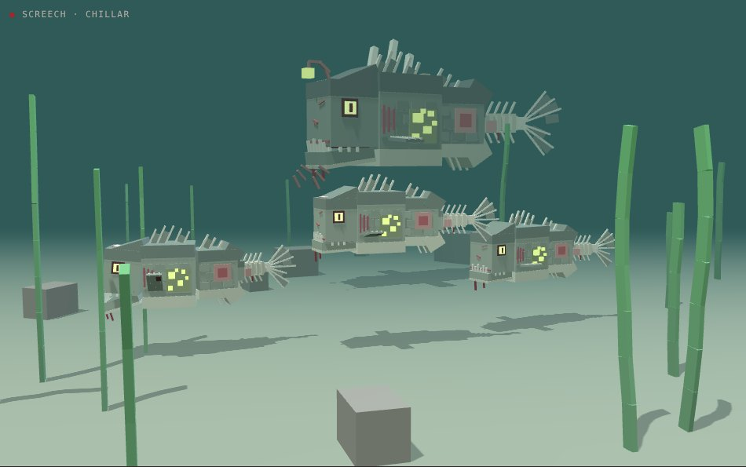

# Pez infectado: criatura acuática de bloques para Roblox

Un pez infectado al estilo Roblox, **hecho de Parts (bloques)** como los humanos infectados: Humanoid, articulaciones con Motor6D y animaciones de nado. No hace falta importar ningún modelo: el instalador lo construye pieza a pieza en Studio, junto con un estanque de prueba.



## Las dos variantes
| Variante | Aspecto | Vida / mordisco | Cómo actúa |
|---|---|---|---|
| **Normal** (7 de cada 8) | Unos 5,5 studs. Colmillos como agujas y mandíbula prognata; un ojo que brilla y el otro colgando de la cuenca; herida abierta con las costillas al aire; pústulas verdes que brillan; gusanos saliendo de las agallas; cráneo al aire; la cola en hueso y la aleta caudal rota | 60 / 12 | Al verte chilla, te rodea 2-4 s y embiste. |
| **Gigante** (1 de cada 8, como máximo uno por zona) | Unos 12 studs y más oscuro: señuelo luminoso en la frente, barbas, púas de hueso que le rompen el lomo, percebes y más pústulas | 320 / 30 | No da vueltas: embiste directo. Salta más lejos (24 studs). |

## Cómo está hecho (`src/fish_blueprints.js`)
- **Rig**: Root (invisible, lo mueve el servidor) → Body → Head → Jaw; Body → Mid → Tail → TailFin; Body → aletas pectorales.
- **Detalles**: 164 bloques soldados el normal y 186 el gigante (173 y 195 piezas en total).
- **Humanoid** sin máquina de estados (`EvaluateStateMachine = false`): no intenta andar, pero **cualquier arma le hace daño**. Las piezas del cuerpo tienen `CanTouch`, así que también las espadas que dañan por contacto.

## Animaciones (`src/fish_anims.js` → `roblox/FishAnimations.lua`)
| Nombre | Qué hace |
|---|---|
| Idle | Flota con una onda lenta y boquea |
| Swim | Nado de crucero: la onda recorre el cuerpo de la cabeza a la cola |
| Charge | Embestida: onda rápida y amplia, aletas pegadas, la boca abierta |
| Bite | Levanta el morro, abre del todo y cierra de golpe |
| Leap | Se arquea al salir del agua, muerde en lo alto y cae coleteando |
| Screech | Chillido: morro arriba y la boca abierta, todo tiembla |
| Hurt | Se sacude al recibir daño |
| Death | Espasmos y queda flácido |

Las reproduce cada cliente con `DragonAnimator` (Roblox no replica `Motor6D.Transform` desde el servidor).

## En el juego
- **Zonas de agua**: viven dentro de partes con la etiqueta `FishZone` (o dentro de `Workspace.FishZones`). La parte cubre el agua: su cara de arriba es la superficie. Suele ser invisible y sin colisión.
- **Bancos**: cada zona tiene un banco de 2 a 4 peces (`MAX_PER_ZONE`). Los muertos reaparecen a los `RESPAWN_DELAY` segundos.
- **En el agua**: si estás dentro de su zona y a su distancia de detección (45 studs; 70 el gigante), chilla, te rodea y embiste. Muerde al llegar, con su recarga.
- **En la orilla**: si estás fuera del agua, cerca del borde y a su alcance de salto (16 studs; 24 el gigante), **salta en arco**, te muerde en el aire y vuelve a caer al agua. Al salir y al caer salpica.
- **Movimiento**: el servidor los mueve con `AlignPosition` y `AlignOrientation`, siempre dentro de su zona.
- **Al morir**: se ponen panza arriba, flotan hasta la superficie y desaparecen a los 10 s.
- **Ajustes**: al principio del instalador, o en `Settings`: `NormalHealth`, `GiantDamage`, `GiantChance`, `NormalLeapRange`…

## Sonido (`sounds/`, generados con `tools/make_sounds.py`, sin muestras de terceros)
| Sonido | Cuándo suena |
|---|---|
| Screech | Chillido húmedo al descubrirte |
| Bite | Mordisco |
| Splash | Al salir del agua y al volver a caer |
| Gurgle | Burbujeo de vez en cuando mientras nada |

Hay que subirlos y pegar sus ids en `SOUND_IDS`.

## Instalación
1. Opcional: sube `sounds/*.ogg` y pega sus ids en `SOUND_IDS`, al principio de `roblox/InstallFish.lua`.
2. Pega todo `roblox/InstallFish.lua` en **View › Command Bar** y pulsa Enter.
   - Construye los dos peces en `ReplicatedStorage.Creatures.InfectedFish.Types`.
   - Crea un **estanque de prueba** (`Workspace.FishPond`) con agua de Terrain, muros de piedra, una rampa para subir al borde y su zona en `Workspace.FishZones`. Se puede desactivar con `DEMO_POND = false` o moverlo con `POND_CENTER`.
   - Deja una vista previa en `Workspace.InfectedFishPreview`, que se borra al jugar.
3. Para tu propio lago o río: una parte que cubra el agua con la etiqueta `FishZone`.
4. **Play**: métete en el agua, o quédate en el borde del muro para ver cómo saltan.

## Qué está verificado y qué no
- ✅ Los planos generan los dos peces en el visor de la ficha; las capturas salen de ahí, con las mismas animaciones que Roblox.
- ✅ El Luau compila sin avisos de `luau-analyze`, y la prueba de paridad Luau ↔ JS de las animaciones pasa.
- ✅ `tools/test_brain.js` comprueba 8 escenarios:
  - que sin nadie nada a su aire, y que no reacciona fuera de su detección;
  - que al verte chilla una sola vez, rodea y luego embiste;
  - que muerde solo a su alcance y respetando la recarga;
  - que el gigante embiste sin rodear;
  - que salta a la orilla respetando la recarga y salpica en cada salto;
  - que el daño no interrumpe un salto;
  - que vuelve a nadar si te pierde;
  - que reacciona al daño y muere una sola vez.
- ⚠️ **No se ha ejecutado dentro de Roblox Studio.** Falta confirmar:
  - el instalador y el estanque de prueba;
  - el movimiento con `AlignPosition` dentro del agua de Terrain (y que la flotabilidad no lo desvíe);
  - el arco del salto y el mordisco en el aire, y cómo se ve con varios jugadores.

## Regenerar
```
python tools/make_sounds.py
node tools/build_roblox.js && node tools/test_anim_parity.js /ruta/a/luau && node tools/test_brain.js /ruta/a/luau
```
